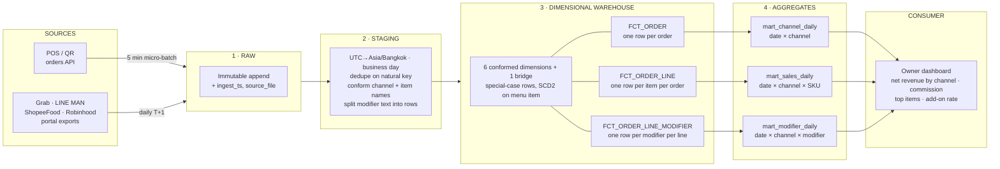

# Pizza Shop Data Platform — Minimal Version

The scope agreed with the teacher: **three fact tables, three aggregate tables, one consumer.** It is the sales
star from section 4 of the full write-up ([`README.md`](README.md)), built end to end so the owner can see
revenue by channel, what sells, and what add-ons earn.

| File | What it is |
|---|---|
| `README-minimal.md` | This document |
| `docs/warehouse-minimal.html` / `docs/warehouse-minimal.th.html` | Presentation page for the minimal version, English and Thai |
| `notebooks/warehouse_minimal.ipynb` | Runnable build: sources → staging → 3 facts → 3 aggregates → owner dashboard. English and Thai |
| `diagrams/minimal-01-pipeline.mmd`, `renders/minimal-01-pipeline.jpg` | Minimal pipeline |
| `diagrams/02-er-sales-orders.mmd`, `renders/02-er-sales-orders.jpg` | The star (figure 2 of the full model holds exactly these three facts) |

---

## 1 · Scope

**In:** the two sales sources (POS / QR and the delivery-app exports), six conformed dimensions, three fact
tables, three aggregate tables, the owner dashboard.

**Out, for now:** stock and reorder, purchasing, staff shifts, payments, promotions and delivery events. They are
designed in the full model and come back as new stars on the same conformed dimensions (section 7).

The design rules are unchanged from the full model and follow MADT8102 chapter 5: a Kimball dimensional
warehouse; `_key` surrogate keys; special-case rows (0 Not applicable, 1 Unknown, 2 Invalid) instead of NULL keys;
a junk dimension for order status; degenerate order and line numbers; facts compared by drilling across.

## 2 · Pipeline

| Layer | Holds | Built |
|---|---|---|
| 1 · Raw | POS and export records as they arrived, plus `source_system`, `ingest_ts`, `source_file` | On ingest |
| 2 · Staging | One shape for order headers, lines and modifiers; Bangkok time; deduplicated | 03:00 |
| 3 · Warehouse | 6 dimensions, 1 bridge, 3 fact tables | 03:00 |
| 4 · Aggregates | 3 tables, one per fact, each feeding the dashboard | 03:30 |

## 3 · The star

```mermaid
erDiagram
  DIM_DATE ||--o{ FCT_ORDER : "business day"
  DIM_CHANNEL ||--o{ FCT_ORDER : "sold via"
  DIM_CUSTOMER ||--o{ FCT_ORDER : "placed by"
  DIM_ORDER_INFO ||--o{ FCT_ORDER : "status"
  DIM_DATE ||--o{ FCT_ORDER_LINE : "business day"
  DIM_CHANNEL ||--o{ FCT_ORDER_LINE : "sold via"
  DIM_CUSTOMER ||--o{ FCT_ORDER_LINE : "placed by"
  DIM_MENU_ITEM ||--o{ FCT_ORDER_LINE : "item sold"
  DIM_ORDER_INFO ||--o{ FCT_ORDER_LINE : "status"
  DIM_DATE ||--o{ FCT_ORDER_LINE_MODIFIER : "business day"
  DIM_CHANNEL ||--o{ FCT_ORDER_LINE_MODIFIER : "sold via"
  DIM_MENU_ITEM ||--o{ FCT_ORDER_LINE_MODIFIER : "on item"
  DIM_MODIFIER ||--o{ FCT_ORDER_LINE_MODIFIER : "applied as"
  DIM_MENU_ITEM ||--o{ BRG_CHANNEL_MENU_ITEM : "listed as"
  DIM_CHANNEL ||--o{ BRG_CHANNEL_MENU_ITEM : "lists"

  DIM_DATE {
    int date_key PK "yyyymmdd; 0 = not applicable"
    date full_date
    string day_name
    int day_of_week
    string weekend_flag "Weekend or Weekday"
    string holiday_flag "Thai holiday or Not a holiday"
    int month_number
    string month_name
    string quarter "hierarchy: day > month > quarter > year"
    int year
    string row_type "Day, Not applicable, Unknown"
  }
  DIM_CHANNEL {
    int channel_key PK
    string channel_code UK "QR_DINEIN, PHONE, GRAB, LINEMAN, SHOPEE, ROBINHOOD"
    string channel_name "QR dine-in, Phone, Grab..."
    string channel_type "Dine-in or Delivery - hierarchy level"
    string channel_ownership "Own channel or Aggregator"
    decimal commission_rate_pct
    string row_type
  }
  DIM_CUSTOMER {
    int customer_key PK "0 = Not applicable (no identified customer)"
    string customer_nk UK "membership or phone hash"
    date first_order_date
    string signup_source
    string membership "Member or Non-member"
    string rfm_segment "behavioral dimension, refreshed monthly"
    date rfm_segment_as_of
    string row_type "Customer, Not applicable, Unknown"
  }
  DIM_MENU_ITEM {
    int menu_item_key PK
    string menu_item_nk "stable business key"
    string item_name
    string category "hierarchy: SKU > item > category"
    string size_code "M, L"
    string size_name "Medium, Large"
    decimal base_price_thb
    date valid_from "SCD2"
    date valid_to "SCD2"
    string current_flag "Current or Expired"
    string row_type "Menu item, Unknown, Invalid"
  }
  BRG_CHANNEL_MENU_ITEM {
    int channel_key FK
    int menu_item_key FK
    string platform_item_id "aggregator's own id"
    string platform_item_name
    decimal channel_price_thb "uplifted platform price"
    string listing_status "Listed or Not listed"
  }
  DIM_MODIFIER {
    int modifier_key PK
    string modifier_nk UK
    string modifier_name "extra cheese, no chili, thin crust"
    string modifier_type "add, remove, substitute"
    string applies_to_category "pizza, chicken, drink"
    decimal default_price_delta_thb
    string active_flag "Active or Retired"
    string row_type
  }
  DIM_ORDER_INFO {
    int order_info_key PK "junk dimension"
    string order_status "completed, cancelled, refunded"
    string cancellation_flag "Cancelled or Not cancelled"
  }
  FCT_ORDER {
    int date_key FK
    int channel_key FK
    int customer_key FK "0 for aggregator and walk-in orders, never NULL"
    int order_info_key FK
    string order_number "degenerate: platform order id"
    timestamp order_ts
    decimal gross_amount_thb
    decimal discount_amount_thb
    decimal delivery_fee_thb
    decimal commission_amount_thb
    decimal net_revenue_thb
  }
  FCT_ORDER_LINE {
    int date_key FK
    int channel_key FK
    int customer_key FK
    int menu_item_key FK "version valid on the business day"
    int order_info_key FK
    string order_number "degenerate"
    int line_number "degenerate"
    int quantity
    decimal unit_price_thb "price at time of order"
    decimal line_discount_thb
    decimal line_net_thb
  }
  FCT_ORDER_LINE_MODIFIER {
    int date_key FK
    int channel_key FK
    int menu_item_key FK
    int modifier_key FK
    string order_number "degenerate"
    int line_number "degenerate"
    int quantity "double extra cheese is qty 2"
    decimal price_delta_thb "snapshot, not joined"
  }
```

| Dimension | Hierarchy and notes |
|---|---|
| `DIM_DATE` | day › month › quarter › year, keyed on the business day (10:00–02:00) |
| `DIM_CHANNEL` | channel › channel type (Dine-in / Delivery); own channel or aggregator; commission rate |
| `DIM_CUSTOMER` | members on own channels; row 0 for orders with no identified customer |
| `DIM_MENU_ITEM` | SKU › item › category; SCD2 on price |
| `DIM_MODIFIER` | extra cheese, no chili…; add / remove / substitute |
| `DIM_ORDER_INFO` | junk dimension: order status, cancellation flag |
| `BRG_CHANNEL_MENU_ITEM` | platform item names and prices → our SKU |

## 4 · Fact tables

| Fact table | Grain: one row = | Dimensions | Measures |
|---|---|---|---|
| `FCT_ORDER` | one order, any channel | date, channel, customer, order info; `order_number` degenerate | gross, discount, delivery fee, commission, net revenue |
| `FCT_ORDER_LINE` | one menu item on one order | date, channel, customer, menu item, order info; `order_number`, `line_number` degenerate | quantity, unit price (snapshot), line discount, line net |
| `FCT_ORDER_LINE_MODIFIER` | one modifier on one order line | date, channel, menu item, modifier; `order_number`, `line_number` degenerate | quantity, price delta (snapshot) |

Three grains, three tables: order-level money (commission, delivery fee) never repeats on line rows, and modifiers
are rows rather than a text column.

## 5 · Aggregate tables

| Aggregate table | Grain: one row = | Built from | Columns |
|---|---|---|---|
| `mart_channel_daily` | business date × channel | `FCT_ORDER` | orders, gross_sales_thb, commission_thb, net_revenue_thb, plus day name, weekend flag, channel type and ownership |
| `mart_sales_daily` | business date × channel × SKU | `FCT_ORDER_LINE` | units_sold, orders, item_sales_thb, plus item name, category, size |
| `mart_modifier_daily` | business date × channel × modifier | `FCT_ORDER_LINE_MODIFIER` | times_applied, modifier_revenue_thb, plus modifier type and item category |

Each is built only from the warehouse, excludes cancelled orders, and stores additive measures only. Ratios such
as average order value are computed by the dashboard from the parts, so they stay correct by day, week or month.

## 6 · Owner dashboard

| Tile | Reads | Prototype result (Fri 4 Sep) |
|---|---|---|
| Net revenue by channel | `mart_channel_daily` | QR 808.0 · Grab 599.9 · Phone 408.0 THB |
| Commission paid | `mart_channel_daily` | 257.1 THB, 12.4% of gross |
| Average net per order | `mart_channel_daily` (net ÷ orders) | QR 404.0 · Phone 408.0 · Grab 299.95 THB |
| Top items | `mart_sales_daily` | Pepperoni L, 7 units over two days |
| Extra cheese per pizza | `mart_modifier_daily` drilled across with `mart_sales_daily` | 2 of 5 pizzas (40%), 80 THB of add-ons |

The extra-cheese tile is a drill across: each aggregate is summarized to the business date first, then the two
are combined, so a line with two modifiers is never double-counted.

## 7 · Growing back to the full model

| Next | Adds | Reuses |
|---|---|---|
| Stock and reorder | `FCT_INVENTORY_MOVEMENT`, `FCT_INVENTORY_COUNT`, `BRG_RECIPE`, `BRG_MODIFIER_RECIPE` | `DIM_DATE`, `DIM_MENU_ITEM`, `DIM_MODIFIER` |
| Delivery times | `FCT_ORDER_EVENT` | `DIM_DATE`, `DIM_CHANNEL` |
| Labour | `FCT_SHIFT`, `DIM_STAFF` | `DIM_DATE` |
| Payments, promotions | `FCT_PAYMENT`, `FCT_ORDER(_LINE)_PROMOTION` | `DIM_DATE`, `DIM_CHANNEL`, `DIM_CUSTOMER`, `DIM_MENU_ITEM` |

Because the dimensions are conformed, each addition is a new star beside these three, not a redesign.
