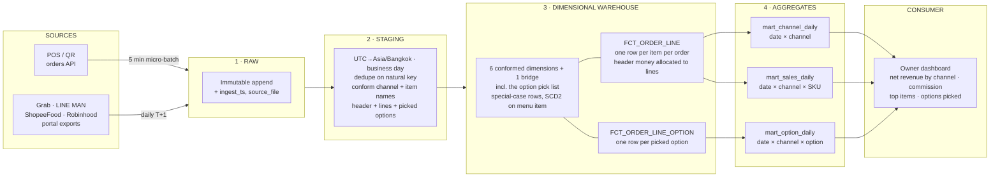

# Pizza Shop Data Platform — Minimal Version

The scope agreed with the teacher: **two fact tables at line grain, three aggregate tables, one consumer.** It is
the sales star from the full write-up ([`README.md`](README.md)), cut down and revised after the second review:

- **An order is a header and its lines are the body; the fact is per line.** `FCT_ORDER_LINE` is the one atomic
  sales fact. The header's commission and delivery fee are allocated down to the lines, and the header survives as
  the degenerate `order_number`.
- **Modifiers are options picked from a list, not free text.** The POS pick list is `DIM_MODIFIER_OPTION`; every
  pick is a row in `FCT_ORDER_LINE_OPTION` with a code, a group and a type that can be counted.

| File | What it is |
|---|---|
| `README-minimal.md` | This document |
| `docs/warehouse-minimal.html` / `docs/warehouse-minimal.th.html` | Presentation page for the minimal version, English and Thai |
| `notebooks/warehouse_minimal.ipynb` | Runnable build: sources → staging → 2 facts → 3 aggregates → owner dashboard. English and Thai |
| `diagrams/minimal-01-pipeline.mmd`, `renders/minimal-01-pipeline.jpg` | Minimal pipeline |
| `diagrams/minimal-02-er-sales-star.mmd`, `renders/minimal-02-er-sales-star.jpg` | The star at line grain |

---

## 1 · Scope

**In:** the two sales sources (POS / QR and the delivery-app exports), six conformed dimensions, two fact tables,
three aggregate tables, the owner dashboard.

**Out, for now:** stock and reorder, purchasing, staff shifts, payments, promotions and delivery events. They are
designed in the full model and come back as new stars on the same conformed dimensions (section 8).

The design follows MADT8102 chapter 5: a Kimball dimensional warehouse; `_key` surrogate keys; special-case rows
(0 Not applicable, 1 Unknown, 2 Invalid) instead of NULL keys; a junk dimension for order status; degenerate order
and line numbers; facts compared by drilling across.

## 2 · Pipeline

| Layer | Holds | Built |
|---|---|---|
| 1 · Raw | POS and export records as they arrived, plus `source_system`, `ingest_ts`, `source_file` | On ingest |
| 2 · Staging | One shape each for order headers, order lines and picked options; Bangkok time; deduplicated | 03:00 |
| 3 · Warehouse | 6 dimensions, 1 bridge, 2 fact tables | 03:00 |
| 4 · Aggregates | 3 tables feeding the dashboard | 03:30 |

## 3 · The star

```mermaid
erDiagram
  DIM_DATE ||--o{ FCT_ORDER_LINE : "business day"
  DIM_CHANNEL ||--o{ FCT_ORDER_LINE : "sold via"
  DIM_CUSTOMER ||--o{ FCT_ORDER_LINE : "placed by"
  DIM_MENU_ITEM ||--o{ FCT_ORDER_LINE : "item sold"
  DIM_ORDER_INFO ||--o{ FCT_ORDER_LINE : "order status"
  DIM_DATE ||--o{ FCT_ORDER_LINE_OPTION : "business day"
  DIM_CHANNEL ||--o{ FCT_ORDER_LINE_OPTION : "sold via"
  DIM_MENU_ITEM ||--o{ FCT_ORDER_LINE_OPTION : "on item"
  DIM_MODIFIER_OPTION ||--o{ FCT_ORDER_LINE_OPTION : "picked"
  DIM_MENU_ITEM ||--o{ BRG_CHANNEL_MENU_ITEM : "listed as"
  DIM_CHANNEL ||--o{ BRG_CHANNEL_MENU_ITEM : "lists"

  DIM_DATE {
    int date_key PK "yyyymmdd business day; 0, 1 special"
    date full_date
    string day_name
    string weekend_flag "Weekend or Weekday"
    string month_name
    string quarter "hierarchy: day > month > quarter > year"
    int year
    string row_type
  }
  DIM_CHANNEL {
    int channel_key PK
    string channel_code UK "QR_DINEIN, PHONE, GRAB, LINEMAN, SHOPEE, ROBINHOOD"
    string channel_name
    string channel_type "Dine-in or Delivery - hierarchy level"
    string channel_ownership "Own channel or Aggregator"
    decimal commission_rate_pct
    string row_type
  }
  DIM_CUSTOMER {
    int customer_key PK "0 = no identified customer"
    string customer_nk UK
    string membership "Member or Non-member"
    string row_type
  }
  DIM_MENU_ITEM {
    int menu_item_key PK
    string menu_item_nk
    string item_name
    string category "hierarchy: SKU > item > category"
    string size_name
    decimal base_price_thb
    date valid_from "SCD2"
    date valid_to "SCD2"
    string row_type
  }
  DIM_MODIFIER_OPTION {
    int option_key PK "2 = Invalid: code not on the pick list"
    string option_code UK "CHEESE_EXTRA, SPICE_NONE, CRUST_THIN"
    string option_name "Extra cheese, No chili, Thin crust"
    string option_group "Cheese, Spice, Crust - hierarchy level"
    string option_type "add, remove, substitute"
    decimal list_price_delta_thb
    string applies_to_category
    string row_type
  }
  DIM_ORDER_INFO {
    int order_info_key PK "junk dimension"
    string order_status
    string cancellation_flag "Cancelled or Not cancelled"
  }
  BRG_CHANNEL_MENU_ITEM {
    int channel_key FK
    int menu_item_key FK
    string platform_item_name
  }
  FCT_ORDER_LINE {
    int date_key FK
    int channel_key FK
    int customer_key FK "0 when no customer, never NULL"
    int menu_item_key FK "version valid on the business day"
    int order_info_key FK
    string order_number "degenerate: the order header"
    int line_number "degenerate: the line"
    int quantity
    decimal unit_price_thb "snapshot"
    decimal item_amount_thb "quantity x unit price"
    decimal option_amount_thb "picked options on this line"
    decimal line_gross_thb "item + options"
    decimal allocated_commission_thb "header commission x line share"
    decimal allocated_delivery_fee_thb "header fee x line share"
    decimal line_net_revenue_thb "gross - allocated commission"
  }
  FCT_ORDER_LINE_OPTION {
    int date_key FK
    int channel_key FK
    int menu_item_key FK
    int option_key FK
    string order_number "degenerate"
    int line_number "degenerate"
    int quantity
    decimal price_delta_thb "snapshot of the price charged"
  }
```

| Dimension | Hierarchy and notes |
|---|---|
| `DIM_DATE` | day › month › quarter › year, keyed on the business day (10:00–02:00) |
| `DIM_CHANNEL` | channel › channel type (Dine-in / Delivery); own channel or aggregator; commission rate |
| `DIM_CUSTOMER` | members on own channels; row 0 for orders with no identified customer |
| `DIM_MENU_ITEM` | SKU › item › category; SCD2 on price |
| `DIM_MODIFIER_OPTION` | the POS pick list: option › option group (Cheese, Spice, Crust); add / remove / substitute; list price |
| `DIM_ORDER_INFO` | junk dimension: order status, cancellation flag |
| `BRG_CHANNEL_MENU_ITEM` | platform item names → our SKU |

## 4 · Header and body: why the fact is per line

The POS and every delivery app send an order as a **header** (who, when, which channel, commission, delivery fee)
and **lines** (one per menu item). The warehouse keeps one sales fact, at the line:

- **Header attributes become dimension keys on every line**: date, channel, customer and order status are the same
  for all lines of an order, so each line carries them.
- **Header money is allocated down.** Commission and delivery fee are split across the order's lines in proportion
  to line gross (item plus picked options), rounded to the satang, with the rounding remainder on the last line.
  On GF-201, 146.4 THB of commission becomes 113.70 on the 379 THB pepperoni and 32.70 on the 109 THB garlic bread.
- **The header itself is the degenerate `order_number`.** An order count is `COUNT(DISTINCT order_number)`.
- **The allocation is reconciled on every load**: allocated commission summed by `order_number` must equal the
  header's, or the load stops.

This gives one grain for every sales measure, so revenue, commission and net revenue roll up the same way by order,
channel, day or item, with no header fact to join and no double-counting.

## 5 · Fact tables

| Fact table | Grain: one row = | Dimensions | Measures |
|---|---|---|---|
| `FCT_ORDER_LINE` | one menu item on one order | date, channel, customer, menu item, order info; `order_number`, `line_number` degenerate | quantity, unit price (snapshot), item amount, option amount, line gross, allocated commission, allocated delivery fee, line net revenue |
| `FCT_ORDER_LINE_OPTION` | one picked option on one order line | date, channel, menu item, option; `order_number`, `line_number` degenerate | quantity, price delta (snapshot) |

**Options are picked, not typed.** The POS screen shows the options in `DIM_MODIFIER_OPTION` for each item and
stores each tap as a row (`order`, `line`, `option_code`, price charged). No free text reaches the warehouse; a code
that is not on the list is loaded against row 2, *Invalid*, with an alert, so it is visible rather than lost.

## 6 · Aggregate tables

| Aggregate table | Grain: one row = | Built from | Columns |
|---|---|---|---|
| `mart_channel_daily` | business date × channel | `FCT_ORDER_LINE` | orders (distinct order numbers), gross_sales_thb, commission_thb, net_revenue_thb, plus day name, weekend flag, channel type and ownership |
| `mart_sales_daily` | business date × channel × SKU | `FCT_ORDER_LINE` | units_sold, orders, item_sales_thb, net_revenue_thb, plus item name, category, size |
| `mart_option_daily` | business date × channel × option | `FCT_ORDER_LINE_OPTION` | times_picked, option_revenue_thb, plus option group and type, item category |

Each is built only from the warehouse, excludes cancelled orders, and stores additive measures only. Ratios such
as average order value are computed by the dashboard from the parts.

## 7 · Owner dashboard

| Tile | Reads | Prototype result (Fri 4 Sep) |
|---|---|---|
| Net revenue by channel | `mart_channel_daily` | QR 808.0 · Grab 599.9 · Phone 408.0 THB |
| Commission paid | `mart_channel_daily` | 257.1 THB, 12.4% of gross |
| Average net per order | `mart_channel_daily` (net ÷ orders) | QR 404.0 · Phone 408.0 · Grab 299.95 THB |
| Top items | `mart_sales_daily` | Pepperoni L, 7 units over two days |
| Options picked, by group | `mart_option_daily` | Cheese: extra cheese ×3 (120 THB); Spice: no chili ×1 |
| Extra cheese per pizza | `mart_option_daily` drilled across with `mart_sales_daily` | 2 of 5 pizzas (40%) |

## 8 · Growing back to the full model

| Next | Adds | Reuses |
|---|---|---|
| Stock and reorder | `FCT_INVENTORY_MOVEMENT`, `FCT_INVENTORY_COUNT`, recipes per item and per option | `DIM_DATE`, `DIM_MENU_ITEM`, `DIM_MODIFIER_OPTION` |
| Delivery times | `FCT_ORDER_EVENT` | `DIM_DATE`, `DIM_CHANNEL` |
| Labour | `FCT_SHIFT`, `DIM_STAFF` | `DIM_DATE` |
| Payments, promotions | `FCT_PAYMENT`, `FCT_ORDER_LINE_PROMOTION` | `DIM_DATE`, `DIM_CHANNEL`, `DIM_CUSTOMER`, `DIM_MENU_ITEM` |

Because the dimensions are conformed, each addition is a new star beside these two, not a redesign.
