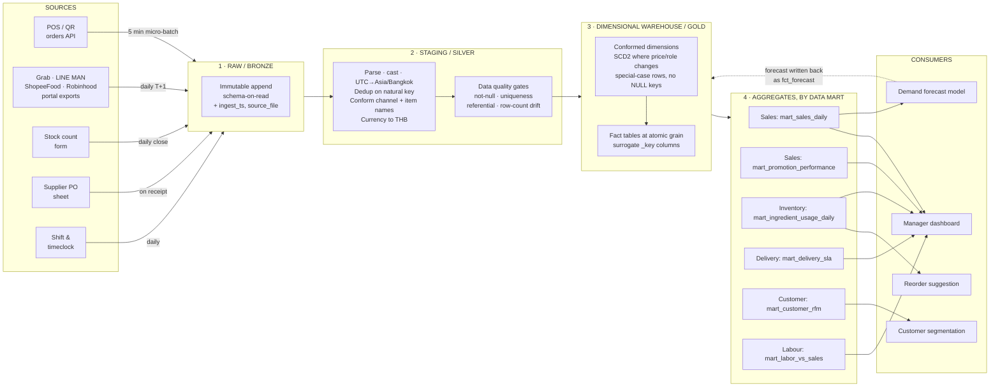
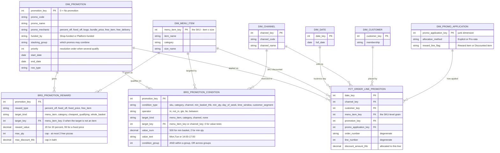
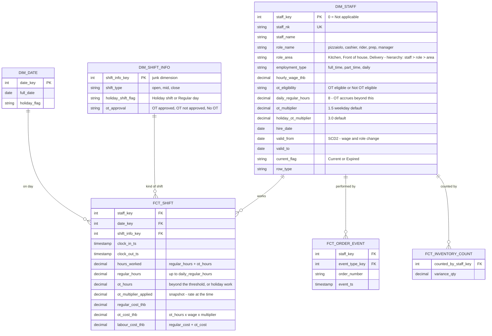

# Pizza Shop Data Platform — Pipeline & ER Model

Class project. Data platform design for a single-location, owner-operated pizza shop in Bangkok
selling across QR dine-in, phone, and four delivery aggregators.

This repository is the full write-up: how data gets from five source systems into a warehouse, the
ER model at each layer, and the decisions worth defending in a review.

> **Minimal version.** The scope agreed with the teacher, three fact tables, three aggregate tables and the
> owner dashboard, is in [`README-minimal.md`](README-minimal.md). This document is the full model it grows into.

## Files

| File | What it is |
|---|---|
| `README.md` | This document — the full write-up, with all six diagrams inline |
| `README-minimal.md` | The minimal version: 3 facts (section 4), 3 aggregate tables, owner dashboard only |
| `docs/warehouse-minimal.html` / `docs/warehouse-minimal.th.html` | Presentation page for the minimal version. English and Thai |
| `notebooks/warehouse_minimal.ipynb` | Runnable minimal build, from sources to the owner dashboard. English and Thai |
| `diagrams/minimal-01-pipeline.mmd` | Minimal pipeline: 2 sources → 3 facts → 3 aggregates → owner dashboard |
| `docs/data-platform.html` | Styled web version of the same write-up |
| `docs/data-flow.html` / `docs/data-flow.th.html` | Data lake design (MADT8102 ch. 4): zone-based pattern, why batch, where each thing happens. English and Thai |
| `docs/warehouse-design.html` / `docs/warehouse-design.th.html` | The project's warehouse spec, from staging to marts: layers and access rules, every dimension and fact table, the chapter 5 conventions each table follows, how the nightly load runs, the five data marts and their six aggregate tables, and build status. English and Thai |
| `notebooks/data_flow_demo.ipynb` | The same flow as runnable code: fake POS / Grab / LINE MAN JSON exports → Landing → Raw (Parquet) → Trusted (DuckDB star schema) → Refined (marts), with dedupe, business day and replay from Raw. English with Thai notes |
| `notebooks/warehouse_design.ipynb` | Why build a warehouse, how ours was designed (4 steps, conformance matrix, SCD2, special-case rows, surrogate key pipeline), and the fact table rules behind every `FCT_*` table, each shown as a small runnable demo. English and Thai, for study |
| `diagrams/01-pipeline-flow.mmd` | Source → raw → staging → dimensional warehouse → aggregates by data mart → consumer flow |
| `diagrams/02-er-sales-orders.mmd` | ER: orders, lines and modifiers, with channels, customers and menu items |
| `diagrams/03-er-inventory-supply.mmd` | ER: ingredients, recipes, stock movements, suppliers, POs |
| `diagrams/04-er-people-shifts.mmd` | ER: staff, shifts, overtime |
| `diagrams/05-er-promotions.mmd` | ER: promotion conditions and rewards |
| `diagrams/06-er-payments-events.mmd` | ER: payments, order events, basket promotions |
| `renders/*.jpg` | All six diagrams exported as JPG at 2× resolution, for slides |

**Running the notebook.** `pip install pandas pyarrow duckdb jupyter`, then open
`notebooks/data_flow_demo.ipynb` and run all cells. It builds a `lake/` folder next to itself
(ignored by git) so you can open the zone folders and Parquet files on disk. GitHub renders the
saved outputs, so it can also just be read.

**Reading it.** The diagrams below render directly on GitHub, and in VS Code (Markdown Preview),
Obsidian, Typora and Notion. For the styled version, clone the repo and open
`docs/data-platform.html` in a browser — GitHub shows `.html` as raw source, so that file only
works locally, and it needs an internet connection on first load because it pulls Mermaid from a
CDN. Ready-made JPGs are in `renders/`; the `.mmd` files also paste straight into
[mermaid.live](https://mermaid.live) if you need a different size or format.

---

## 1 · Scope and assumptions

One store, so there is no `dim_store` — location is a constant, not a dimension. Everything is
modelled at the grain a single manager can act on: a day, a menu item, a channel, an ingredient,
a shift.

- **Forecast grain is menu item × business day × channel.** The load-bearing assumption: it makes
  the sales mart a daily item-level table rather than revenue-only, which is what makes ingredient
  forecasting possible downstream.
- **Business day ≠ calendar day.** The shop trades past midnight, so a business day runs
  10:00–02:00 Asia/Bangkok. Every fact carries both `order_ts` and the business-day `date_key`.
- **Aggregator orders are anonymous.** Grab, LINE MAN, ShopeeFood and Robinhood do not hand over
  customer identity. Membership and segmentation are *own-channel only*.
- **Stock is not "order ±10%".** Consumption is *derived* from a recipe, then *reconciled* against
  physical counts. The 10% is the variance you measure, not a rule you hard-code.

## 2 · Source systems

| Source | What it gives | Format / access | Cadence | Natural key |
|---|---|---|---|---|
| POS / QR ordering | Dine-in and walk-in orders, lines, payments, kitchen status | App DB or POS API | Near real-time (5 min micro-batch) | `pos_order_id` |
| Aggregators ×4 | Platform orders, lines, promo, commission, courier timestamps | Merchant-portal CSV export or partner API | Daily (T+1, some settle T+7) | `(platform, platform_order_id)` |
| Inventory counts | Physical stock on hand by ingredient | Tablet form / Google Sheet | Daily close + weekly full count | `(count_session_id, ingredient_id)` |
| Purchasing | Supplier POs, goods receipts, unit cost | Sheet or supplier invoice entry | On delivery (2–3× / week) | `po_line_id` |
| Staff & shifts | Roster, clock-in/out, role, wage rate | Scheduling app / sheet | Daily | `(staff_id, shift_start)` |

> **Why this matters:** POS is streaming-ish and trustworthy; aggregator data is late, batched,
> schema-drifting, and arrives once per platform with four different column names for "order total".
> Nothing downstream of staging should care which of the five it came from — that is the entire job
> of the conform layer.

## 3 · Pipeline architecture

### Layer contracts

| Layer | Guarantee | Deliberately not done here |
|---|---|---|
| 1 · Raw | Nothing is ever lost or edited. Every row keeps `source_system`, `ingest_ts`, `source_file`, raw payload. | No typing, no dedup, no joins. |
| 2 · Staging | One row per real-world event. Types cast, timestamps in Asia/Bangkok, channel and item names conformed, duplicates removed. | No business aggregation, no KPI logic. |
| 3 · Core | Star schema at atomic grain. Every fact has a declared grain and only surrogate keys; no NULL keys (special-case rows). History preserved via SCD2. | No presentation shaping, no channel-specific hacks. |
| 4 · Aggregates | One table per question, pre-aggregated, serving one data mart (subject area). | No re-derivation of business rules — those live in core. |

Architecturally this is a **Kimball dimensional data warehouse**: one integrated set of stars on
conformed dimensions, where a data mart is a subject area within the warehouse. Section 11 lists
the dimensional conventions every table follows.

## 4 · ER model — sales and orders

Grain declarations:

- `FCT_ORDER` — one row per order (any channel)
- `FCT_ORDER_LINE` — one row per menu item per order
- `FCT_ORDER_EVENT` — one row per status transition per order
- `FCT_PAYMENT` — one row per tender per order (split payments are normal)
- `FCT_ORDER_LINE_MODIFIER` — one row per modifier per order line

Every fact carries its own keys to date, channel, customer and the rest; facts never point at each
other. `order_number` and `line_number` are degenerate dimensions, and two facts are compared by
drilling across them (section 11). Payments, order events and basket promotions are in figure 6.

```mermaid
erDiagram
  DIM_DATE ||--o{ FCT_ORDER : "business day"
  DIM_CHANNEL ||--o{ FCT_ORDER : "sold via"
  DIM_CUSTOMER ||--o{ FCT_ORDER : "placed by"
  DIM_ORDER_INFO ||--o{ FCT_ORDER : "status"
  DIM_DATE ||--o{ FCT_ORDER_LINE : "business day"
  DIM_CHANNEL ||--o{ FCT_ORDER_LINE : "sold via"
  DIM_CUSTOMER ||--o{ FCT_ORDER_LINE : "placed by"
  DIM_MENU_ITEM ||--o{ FCT_ORDER_LINE : "item sold"
  DIM_ORDER_INFO ||--o{ FCT_ORDER_LINE : "status"
  DIM_DATE ||--o{ FCT_ORDER_LINE_MODIFIER : "business day"
  DIM_CHANNEL ||--o{ FCT_ORDER_LINE_MODIFIER : "sold via"
  DIM_MENU_ITEM ||--o{ FCT_ORDER_LINE_MODIFIER : "on item"
  DIM_MODIFIER ||--o{ FCT_ORDER_LINE_MODIFIER : "applied as"
  DIM_MENU_ITEM ||--o{ BRG_CHANNEL_MENU_ITEM : "listed as"
  DIM_CHANNEL ||--o{ BRG_CHANNEL_MENU_ITEM : "lists"

  DIM_DATE {
    int date_key PK "yyyymmdd; 0 = not applicable"
    date full_date
    string day_name
    int day_of_week
    string weekend_flag "Weekend or Weekday"
    string holiday_flag "Thai holiday or Not a holiday"
    int month_number
    string month_name
    string quarter "hierarchy: day > month > quarter > year"
    int year
    string row_type "Day, Not applicable, Unknown"
  }
  DIM_CHANNEL {
    int channel_key PK
    string channel_code UK "QR_DINEIN, PHONE, GRAB, LINEMAN, SHOPEE, ROBINHOOD"
    string channel_name "QR dine-in, Phone, Grab..."
    string channel_type "Dine-in or Delivery - hierarchy level"
    string channel_ownership "Own channel or Aggregator"
    decimal commission_rate_pct
    string row_type
  }
  DIM_CUSTOMER {
    int customer_key PK "0 = Not applicable (no identified customer)"
    string customer_nk UK "membership or phone hash"
    date first_order_date
    string signup_source
    string membership "Member or Non-member"
    string rfm_segment "behavioral dimension, refreshed monthly"
    date rfm_segment_as_of
    string row_type "Customer, Not applicable, Unknown"
  }
  DIM_MENU_ITEM {
    int menu_item_key PK
    string menu_item_nk "stable business key"
    string item_name
    string category "hierarchy: SKU > item > category"
    string size_code "M, L"
    string size_name "Medium, Large"
    decimal base_price_thb
    date valid_from "SCD2"
    date valid_to "SCD2"
    string current_flag "Current or Expired"
    string row_type "Menu item, Unknown, Invalid"
  }
  BRG_CHANNEL_MENU_ITEM {
    int channel_key FK
    int menu_item_key FK
    string platform_item_id "aggregator's own id"
    string platform_item_name
    decimal channel_price_thb "uplifted platform price"
    string listing_status "Listed or Not listed"
  }
  DIM_MODIFIER {
    int modifier_key PK
    string modifier_nk UK
    string modifier_name "extra cheese, no chili, thin crust"
    string modifier_type "add, remove, substitute"
    string applies_to_category "pizza, chicken, drink"
    decimal default_price_delta_thb
    string active_flag "Active or Retired"
    string row_type
  }
  DIM_ORDER_INFO {
    int order_info_key PK "junk dimension"
    string order_status "completed, cancelled, refunded"
    string cancellation_flag "Cancelled or Not cancelled"
  }
  FCT_ORDER {
    int date_key FK
    int channel_key FK
    int customer_key FK "0 for aggregator and walk-in orders, never NULL"
    int order_info_key FK
    string order_number "degenerate: platform order id"
    timestamp order_ts
    decimal gross_amount_thb
    decimal discount_amount_thb
    decimal delivery_fee_thb
    decimal commission_amount_thb
    decimal net_revenue_thb
  }
  FCT_ORDER_LINE {
    int date_key FK
    int channel_key FK
    int customer_key FK
    int menu_item_key FK "version valid on the business day"
    int order_info_key FK
    string order_number "degenerate"
    int line_number "degenerate"
    int quantity
    decimal unit_price_thb "price at time of order"
    decimal line_discount_thb
    decimal line_net_thb
  }
  FCT_ORDER_LINE_MODIFIER {
    int date_key FK
    int channel_key FK
    int menu_item_key FK
    int modifier_key FK
    string order_number "degenerate"
    int line_number "degenerate"
    int quantity "double extra cheese is qty 2"
    decimal price_delta_thb "snapshot, not joined"
  }
```

`BRG_CHANNEL_MENU_ITEM` is what lets a Grab listing and a QR listing of the same pizza roll up to
one item.

**Figure 6 · Payments, order events and basket promotions**

```mermaid
erDiagram
  DIM_DATE ||--o{ FCT_ORDER_EVENT : "business day"
  DIM_CHANNEL ||--o{ FCT_ORDER_EVENT : "sold via"
  DIM_EVENT_TYPE ||--o{ FCT_ORDER_EVENT : "transition"
  DIM_STAFF ||--o{ FCT_ORDER_EVENT : "performed by"
  DIM_DATE ||--o{ FCT_PAYMENT : "paid on / settled on (roles)"
  DIM_CHANNEL ||--o{ FCT_PAYMENT : "sold via"
  DIM_CUSTOMER ||--o{ FCT_PAYMENT : "paid by"
  DIM_PAYMENT_INFO ||--o{ FCT_PAYMENT : "tender"
  DIM_DATE ||--o{ FCT_ORDER_PROMOTION : "business day"
  DIM_CHANNEL ||--o{ FCT_ORDER_PROMOTION : "sold via"
  DIM_PROMOTION ||--o{ FCT_ORDER_PROMOTION : "basket-level"

  DIM_DATE {
    int date_key PK
    date full_date
    string month_name
  }
  DIM_CHANNEL {
    int channel_key PK
    string channel_code
    string channel_name
  }
  DIM_CUSTOMER {
    int customer_key PK "0 = Not applicable"
    string membership
  }
  DIM_EVENT_TYPE {
    int event_type_key PK
    string event_type "placed, accepted, prep_start, prep_complete, courier_pickup, delivered, cancelled"
    int event_sequence
    string event_stage "Kitchen or Delivery"
  }
  DIM_STAFF {
    int staff_key PK "0 = Not applicable (platform event)"
    string staff_name
    string role_name
  }
  DIM_PAYMENT_INFO {
    int payment_info_key PK "junk dimension"
    string tender_type "cash, promptpay_qr, card, platform_settled"
    string settlement_mode "Shop-collected or Platform-settled"
  }
  DIM_PROMOTION {
    int promotion_key PK "0 = No promotion"
    string promo_code
    string promo_name
    string promo_mechanic "percent_off, fixed_off, bogo, bundle_price, free_item, free_delivery"
    string funded_by "Shop-funded or Platform-funded"
    string stacking_group "which promos may combine"
    int priority "resolution order when several qualify"
    date start_date
    date end_date
    string row_type
  }
  FCT_ORDER_EVENT {
    int date_key FK
    int channel_key FK
    int event_type_key FK
    int staff_key FK
    string order_number "degenerate"
    timestamp event_ts
    int duration_from_prev_sec
  }
  FCT_PAYMENT {
    int paid_date_key FK "role of DIM_DATE"
    int settlement_date_key FK "role of DIM_DATE; 0 until settled"
    int channel_key FK
    int customer_key FK
    int payment_info_key FK
    string order_number "degenerate"
    timestamp paid_ts
    decimal amount_thb
  }
  FCT_ORDER_PROMOTION {
    int date_key FK
    int channel_key FK
    int promotion_key FK
    string order_number "degenerate"
    decimal discount_amount_thb "basket-level total"
  }
```

### Modifiers are rows, not JSON

`FCT_ORDER_LINE` used to carry `modifiers_json` — a string holding `"extra cheese, no chili"`. That
is a repeating group hidden inside a column, so no query can total extra-cheese sales without
string matching. But the expensive part is not reporting, it is **inventory**.

Theoretical usage is derived as `FCT_ORDER_LINE × BRG_RECIPE`, and `BRG_RECIPE` explodes a *menu
item*. Extra cheese is roughly 40 g of mozzarella that no recipe knows about — physically consumed,
never counted as usage, and therefore landing in variance as unexplained shrinkage. A JSON blob
quietly corrupts the exact number this whole model exists to produce (section 1: "the 10% is the
variance you measure").

So modifiers get the same treatment as anything else that moves stock:

- `DIM_MODIFIER` — the catalogue, with `modifier_type` (add / remove / substitute)
- `FCT_ORDER_LINE_MODIFIER` — grain: order line × modifier, with `price_delta_thb` snapshotted
- `BRG_MODIFIER_RECIPE` (figure 3) — what a modifier consumes, **signed**: extra cheese `+40 g`,
  no chili `−5 g`

Theoretical usage becomes the sum of two explosions rather than one. Without the third table the
first two are just tidier reporting; with it, the variance number is finally honest.

### Promotions: what it looked like, and what changed

The original model attached promotions to the **order** only — `FCT_ORDER_PROMOTION` carried one
`discount_amount_thb` per order per promotion, and `DIM_PROMOTION.promo_type` held a label like
`bogo`. Three things were impossible:

- **Item margin after discount.** A 100 THB discount on a 600 THB basket sat at basket level, so no
  line knew it had been discounted. Food cost % and menu engineering were computed against
  undiscounted revenue — i.e. wrong for exactly the items being promoted.
- **`bogo` had no object.** The label said "buy one get one" and nothing said *of what*.
- **No condition could be expressed.** "20% off pizzas over 500 THB, weekdays, own channels only"
  had nowhere to live except a human's memory.

The fix separates two things that were being conflated:

| | Question it answers | Table |
|---|---|---|
| **Definition** | What *is* this promotion — what qualifies, what do you get? | `BRG_PROMOTION_CONDITION` + `BRG_PROMOTION_REWARD` |
| **Application** | What did it actually *do* to this basket? | `FCT_ORDER_LINE_PROMOTION` |

**By SKU.** `DIM_MENU_ITEM` is already at SKU grain — it carries `size_code`, so "Hawaiian M" and
"Hawaiian L" are separate rows with separate `menu_item_key`. Targeting by SKU therefore needs no new
dimension; it needs a *reference* to one. `FCT_ORDER_LINE_PROMOTION` is grained at order line ×
promotion, which is the SKU-level answer: every discounted baht is attributable to one sold SKU.

**By condition.** Conditions become **rows, not columns**. Each row is one test —
`condition_type` (sku, category, channel, min_basket_thb, min_qty, day_of_week, time_window,
customer_segment), an `operator`, and either a `target_key` pointing at an item or channel, or a
plain `value_num`. Rows sharing a `condition_group` are ANDed; separate groups are ORed. Rewards
work the same way, with caps (`max_qty`, `max_discount_thb`) so an open-ended promo cannot run away.

This is what keeps a new mechanic from becoming a schema change. "Buy 2 pizzas, get the cheapest
garlic bread free, Mon–Thu, dine-in only" is four condition rows and one reward row — no new column.

## 5 · ER model — promotion rules

Grain declarations:

- `BRG_PROMOTION_CONDITION` — one row per condition per promotion
- `BRG_PROMOTION_REWARD` — one row per reward per promotion
- `FCT_ORDER_LINE_PROMOTION` — one row per order line per promotion

**Two rules the pipeline has to enforce**, because the schema alone cannot:

1. **Order-level discounts are allocated down to lines.** Free delivery and basket-level percent-off
   have no natural line, so staging spreads them pro-rata across qualifying lines and stamps
   `allocation_method = 'pro_rata'`. Without this, item margin stays fiction.
2. **The two facts must reconcile.** Drilling across both by `order_number`,
   `SUM(FCT_ORDER_LINE_PROMOTION.discount) = SUM(FCT_ORDER_PROMOTION.discount)` for every order. That equality is a
   data quality test, not a hope — it is the only thing standing between allocated discount and
   quietly invented revenue.

## 6 · ER model — inventory and supply

```mermaid
erDiagram
  DIM_MENU_ITEM ||--|{ BRG_RECIPE : "made from"
  DIM_INGREDIENT ||--o{ BRG_RECIPE : "used in"
  DIM_MODIFIER ||--o{ BRG_MODIFIER_RECIPE : "consumes"
  DIM_INGREDIENT ||--o{ BRG_MODIFIER_RECIPE : "used in"
  DIM_SUPPLIER ||--o{ BRG_SUPPLIER_DELIVERY_DAY : "delivers on"
  DIM_INGREDIENT ||--o{ FCT_INVENTORY_MOVEMENT : "moves"
  DIM_DATE ||--o{ FCT_INVENTORY_MOVEMENT : "on day"
  DIM_MOVEMENT_INFO ||--o{ FCT_INVENTORY_MOVEMENT : "kind"
  DIM_MENU_ITEM ||--o{ FCT_INVENTORY_MOVEMENT : "used by item"
  DIM_MODIFIER ||--o{ FCT_INVENTORY_MOVEMENT : "used by modifier"
  DIM_SUPPLIER ||--o{ FCT_INVENTORY_MOVEMENT : "received from"
  DIM_INGREDIENT ||--o{ FCT_INVENTORY_COUNT : "counted"
  DIM_DATE ||--o{ FCT_INVENTORY_COUNT : "on day"
  DIM_STAFF ||--o{ FCT_INVENTORY_COUNT : "counted by"
  DIM_SUPPLIER ||--o{ FCT_PURCHASE_ORDER : supplies
  DIM_DATE ||--o{ FCT_PURCHASE_ORDER : "ordered on / received on (roles)"
  DIM_PO_INFO ||--o{ FCT_PURCHASE_ORDER : "status"
  DIM_SUPPLIER ||--o{ FCT_PURCHASE_ORDER_LINE : supplies
  DIM_INGREDIENT ||--o{ FCT_PURCHASE_ORDER_LINE : "purchased"
  DIM_DATE ||--o{ FCT_PURCHASE_ORDER_LINE : "ordered on / received on (roles)"
  DIM_PO_INFO ||--o{ FCT_PURCHASE_ORDER_LINE : "status"

  DIM_INGREDIENT {
    int ingredient_key PK
    string ingredient_nk UK
    string ingredient_name "mozzarella, 00 flour, pepperoni"
    string category "dairy, dry_good, protein, produce, packaging - hierarchy level"
    string base_uom "gram, ml, piece"
    decimal shelf_life_days
    decimal reorder_point_qty
    decimal safety_stock_qty
    string preferred_supplier_nk "denormalized, not a snowflake"
    string preferred_supplier_name
    string row_type
  }
  BRG_RECIPE {
    int menu_item_key FK
    int ingredient_key FK
    decimal qty_per_unit "in ingredient base_uom"
    decimal yield_loss_pct "trim and prep loss"
    date valid_from "SCD2 - recipes change"
    date valid_to
  }
  DIM_SUPPLIER {
    int supplier_key PK "0 = Not applicable"
    string supplier_nk UK
    string supplier_name
    string contact_phone
    int lead_time_days
    int min_order_value_thb
    string row_type
  }
  BRG_SUPPLIER_DELIVERY_DAY {
    int supplier_key FK
    int day_of_week "1=Mon .. 7=Sun, one row per day"
    string day_name
    time order_cutoff_time "order after this and it ships next delivery day"
  }
  DIM_MODIFIER {
    int modifier_key PK "0 = Not applicable"
    string modifier_name
  }
  DIM_MENU_ITEM {
    int menu_item_key PK "0 = Not applicable"
    string item_name
  }
  DIM_STAFF {
    int staff_key PK
    string staff_name
  }
  BRG_MODIFIER_RECIPE {
    int modifier_key FK
    int ingredient_key FK
    decimal qty_delta_per_unit "signed - extra cheese +40g, no chili -5g"
    date valid_from "SCD2"
    date valid_to
  }
  DIM_PO_INFO {
    int po_info_key PK "junk dimension"
    string po_status "draft, sent, received, cancelled"
    string receipt_status "Fully received, Short-shipped, Pending"
  }
  DIM_MOVEMENT_INFO {
    int movement_info_key PK "junk dimension"
    string movement_type "receipt, theoretical_usage, waste, spoilage, count_adjustment, staff_meal"
    string direction "In or Out - CHECK sign of qty_delta"
    string source_document_type "Order line, Order line modifier, PO line, Stock count, None"
  }
  FCT_PURCHASE_ORDER {
    int supplier_key FK
    int order_date_key FK "role of DIM_DATE"
    int received_date_key FK "role of DIM_DATE; 0 until received"
    int po_info_key FK
    string po_number "degenerate"
    decimal total_cost_thb
  }
  FCT_PURCHASE_ORDER_LINE {
    int supplier_key FK
    int ingredient_key FK
    int order_date_key FK "role"
    int received_date_key FK "role"
    int po_info_key FK
    string po_number "degenerate"
    int po_line_number "degenerate"
    decimal qty_ordered
    decimal qty_received
    decimal unit_cost_thb "cost at time of purchase"
  }
  FCT_INVENTORY_MOVEMENT {
    int ingredient_key FK
    int date_key FK
    int movement_info_key FK
    int menu_item_key FK "theoretical usage; else 0"
    int modifier_key FK "modifier usage; else 0"
    int supplier_key FK "receipt; else 0"
    string source_document_number "degenerate: order, PO or count number; n/a for waste"
    int source_line_number "degenerate; 0 when none"
    timestamp movement_ts
    decimal qty_delta "signed, base_uom"
    decimal unit_cost_thb
  }
  FCT_INVENTORY_COUNT {
    int ingredient_key FK
    int date_key FK
    int counted_by_staff_key FK "role of DIM_STAFF"
    string count_session_id "degenerate"
    decimal qty_counted
    decimal qty_expected "system theoretical on-hand"
    decimal variance_qty "counted minus expected"
    decimal variance_value_thb
  }
```

Theoretical usage flows in from `FCT_ORDER_LINE` via `BRG_RECIPE` **and** from
`FCT_ORDER_LINE_MODIFIER` via `BRG_MODIFIER_RECIPE`; physical truth flows in from
`FCT_INVENTORY_COUNT`; the gap between them is the number the manager gets paid to shrink.

### Delivery days are a table, not a string

`DIM_SUPPLIER.delivery_days` used to hold `"Mon,Thu"`. Same defect as `modifiers_json` — a list
crammed into a scalar — and it breaks something specific. The closed loop in section 9 says the
reorder suggestion respects `lead_time_days` **and** `delivery_days`; you cannot compute "the next
delivery date after today" from a comma-separated string without parsing text in SQL, and "which
suppliers deliver on Tuesday" is not answerable at all.

`BRG_SUPPLIER_DELIVERY_DAY` is one row per supplier per weekday. It also carries
`order_cutoff_time`, because "order by 16:00 or it ships the following delivery day" moves the
recommended order date by a full day — and that date is the thing the manager acts on.

### Where a movement came from: dimension keys plus a typed document reference

`FCT_INVENTORY_MOVEMENT.source_ref_sk` began as a single key meaning "order_line_sk or po_line_sk":
a **polymorphic foreign key**, whose overlapping key spaces let a wrong-table join return wrong rows
silently. The first fix split it into four nullable foreign keys pointing at other fact tables.
That still broke two chapter 5 rules: facts referencing facts, and NULL foreign keys.

The movement now answers "where did this come from?" in two separate ways:

- **For analysis, dimension keys.** `menu_item_key` (theoretical usage), `modifier_key` (modifier
  usage) and `supplier_key` (receipts), each pointing at row 0, *Not applicable*, when it does not
  apply. Usage by item, by modifier or by supplier is an ordinary star query, and no key is NULL.
- **For lineage, a typed degenerate reference.** `source_document_number` + `source_line_number`
  (an order number, a PO number or a count session; `n/a` for waste), with its type held in
  `DIM_MOVEMENT_INFO.source_document_type`. This is the `ref_table` + `ref_id` form suggested in
  the earlier review. Chapter 5 is explicit that in an analytic database referential integrity is
  enforced by the ETL, so the load checks every reference against its source fact; and because
  no analysis query joins on it, the wrong-table join that made the original key dangerous has
  nothing to run on.

`qty_delta` stays a single signed `decimal` — stock on hand is `SUM(qty_delta)`, one expression with
no term to forget — and the guard against a receipt booked as an outflow is a CHECK tying the sign
to `DIM_MOVEMENT_INFO.direction`.

## 7 · ER model — people and shifts

Staff data only earns its place if it joins to something. Here it joins twice: to shifts (labour
cost per hour) and to order events (who was on the pass when tickets ran late).

### Overtime

`hours_worked` alone cannot cost a shift, because not every hour costs the same. OT is split out
into its own measures rather than folded into a single number:

- **`regular_hours` and `ot_hours` are separate columns on `FCT_SHIFT`.** Labour cost % is
  meaningless if a 1.5× hour is counted as a 1.0× hour, and "how much OT did we burn last month"
  is a question the manager will ask before any other labour question.
- **`ot_multiplier_applied` is snapshotted onto the fact.** Same argument as `unit_price_thb` on the
  order line: the multiplier is policy, policy changes, and a changed policy must not silently
  rewrite what last quarter's overtime cost. `DIM_STAFF` holds the *current* default
  (`ot_multiplier`, `holiday_ot_multiplier`); the fact holds what was actually used.
- **`ot_eligibility` sits on `DIM_STAFF`.** Salaried managers typically accrue no OT. Without the
  flag, their long days inflate the OT figure and hide the OT that is real.
- **OT approval sits in the `DIM_SHIFT_INFO` junk dimension.** Approved and unapproved overtime
  cost the same money but mean different things — one is a staffing decision, the other is a
  finding. The same junk dimension carries the shift type and whether it was a holiday shift.
- **Role lives on `DIM_STAFF`, not in its own table.** A role is a natural affinity of the staff
  member, so it is stored on the same row (no snowflake); SCD2 keeps the history when someone moves
  from prep to pizzaiolo.

**One honest caveat about grain.** OT is legally a *daily* concept (hours beyond the daily
threshold), while `FCT_SHIFT` is grained per shift. If someone works two shifts in one business day,
the threshold spans both, so `regular_hours` / `ot_hours` must be computed at staff × business_date
and then allocated back to shifts — not computed per shift in isolation. The multipliers shown
(1.5× weekday, 3.0× holiday) are the common Thai defaults and should be confirmed against the
Labour Protection Act before anyone runs payroll off this.

## 8 · Modelling decisions worth defending

**01 · Multi-channel order provenance.** Every order carries `channel_key` plus the platform's own
`order_number`. Dedup and idempotent reload both key on **(channel_key, order_number)**,
so re-running yesterday's Grab export cannot double-count revenue.

**02 · Recipe-driven stock, not a fixed percentage.** `BRG_RECIPE` gives grams-per-pizza, so
*theoretical usage* is derived from order lines; `FCT_INVENTORY_COUNT` supplies *actual on-hand*.
Variance = theoretical − actual, and that variance is the waste/shrinkage KPI. The 10% is an output
of the system, not an input to it.

**03 · Price is stored twice, on purpose.** `FCT_ORDER_LINE.unit_price_thb` is an immutable
snapshot — a receipt reprinted in 2027 must show 2026's price. `DIM_MENU_ITEM` is SCD2 so you can
still ask "what did margin look like before the March price rise". Snapshot answers *what
happened*; SCD2 answers *what was true*.

**04 · Membership only exists on own channels.** Aggregator orders point `customer_key` at row 0,
*Not applicable*, rather than storing NULL. RFM segmentation is scoped to QR and phone orders and
the dashboard must label it that way; inventing a customer for every order would make the
segmentation story fiction.

**05 · Delivery timing is an event log, not columns.** `FCT_ORDER_EVENT` records each transition,
so any duration is a difference between two rows — prep time, pickup wait, total lead time —
without schema changes. Coverage is honestly uneven: QR gives full kitchen granularity, aggregators
typically give accepted/pickup/delivered only.

**06 · Payment, promotion and commission are separate from the order.** Split tenders (half
PromptPay, half cash) need their own rows. Platform-funded vs shop-funded promotions land on
different lines of the P&L. And `commission_amount_thb` is what turns gross revenue into the only
number that matters — net revenue the shop actually banks, which differs by up to 30% between
channels.

**07 · A promotion's definition and its effect are different tables.** Conditions and rewards
(`BRG_PROMOTION_*`) say what the promo *is*; `FCT_ORDER_LINE_PROMOTION` says what it *did*, at SKU
grain. Storing conditions as rows rather than columns is what lets a new mechanic ship without a
migration — and pushing the discount down to the line is what keeps item margin from being fiction.
See section 4.

**08 · Overtime is measured, not averaged.** `regular_hours` and `ot_hours` are separate on
`FCT_SHIFT`, and the multiplier used is snapshotted alongside them. A blended labour rate would be
simpler and would hide the single most controllable cost line the manager has.

**09 · No list lives in a scalar, and no foreign key is polymorphic.** Three fields broke this and
all three were fixed: `modifiers_json`, `DIM_SUPPLIER.delivery_days`, and
`FCT_INVENTORY_MOVEMENT.source_ref_sk`. The first two are 1NF violations that silently disable a
join; the third is worse, because an overloaded key returns wrong rows instead of failing. Sections
4 and 6 argue each one.

**10 · Facts carry their own keys and are compared by drilling across.** `FCT_ORDER_LINE` holds
`date_key`, `channel_key` and `customer_key` itself instead of reaching them through `FCT_ORDER`.
Joining two facts through a shared parent double-counts the parent's measures; summarizing each
fact first and combining on conformed dimensions does not.

**11 · No NULL keys, no snowflakes.** Every dimension has Not applicable / Unknown / Invalid rows,
so late or bad data is loaded and flagged rather than dropped, and every attribute that describes a
staff member, a menu item or an ingredient sits on that one dimension row. Section 11 has the full
list of conventions.

## 9 · Data marts, aggregates, dashboard and ML

Each aggregate table serves one data mart, the subject area it is named after (section 11).

| Aggregate table | Grain | Built from | Serves |
|---|---|---|---|
| `mart_sales_daily` | business date × channel × menu item | FCT_ORDER + FCT_ORDER_LINE + dims | Sales dashboard; training set for demand forecast |
| `mart_ingredient_usage_daily` | business date × ingredient | FCT_ORDER_LINE × BRG_RECIPE **+** FCT_ORDER_LINE_MODIFIER × BRG_MODIFIER_RECIPE, vs FCT_INVENTORY_COUNT | Waste %, variance alerts, reorder suggestions |
| `mart_delivery_sla` | order | FCT_ORDER_EVENT pivoted to durations | Prep-time and lead-time distributions by channel and hour |
| `mart_customer_rfm` | customer (own channels) | FCT_ORDER where `customer_key` is a real customer (not row 0) | Segmentation, win-back campaigns via LINE; also refreshes the behavioral `DIM_CUSTOMER.rfm_segment` monthly |
| `mart_labor_vs_sales` | business date × hour | FCT_SHIFT + FCT_ORDER | Labour cost %, OT cost and OT share, understaffed-hour detection |
| `mart_promotion_performance` | promotion × business date × menu item | FCT_ORDER_LINE_PROMOTION × BRG_PROMOTION_REWARD | Discount spend per SKU, incremental units, margin after discount |

### The closed loop

`mart_sales_daily` → forecast units per **item × day × channel** → multiply through `BRG_RECIPE` →
forecast **grams per ingredient** → subtract current on-hand from `FCT_INVENTORY_MOVEMENT`, add
`safety_stock_qty`, respect supplier `lead_time_days` and `BRG_SUPPLIER_DELIVERY_DAY` (including
`order_cutoff_time`) → **a purchase order the manager can approve with one tap.**

Forecasts are written back as `fct_forecast` (grain: item × day × channel × forecast run) so
predicted-vs-actual error is itself a table you can chart. A model you cannot score is a model you
cannot trust.

### Dashboard, top screen

- **Net revenue by channel** — gross minus commission minus shop-funded promos. Almost never what the platform app tells you.
- **Today vs forecast**, live, with the gap called out.
- **Items at risk** — ingredients where projected demand exceeds on-hand before the next delivery day.
- **Variance watch** — ingredients whose theoretical-vs-counted gap breaches its threshold.
- **Prep time p50 / p90 by hour** — where the kitchen breaks, not just that it did.

## 10 · Data quality rules

| Risk | Where it bites | Rule |
|---|---|---|
| Double ingestion | Aggregator export re-downloaded | Merge key `(channel_key, order_number)`; upsert, never append |
| Late-arriving orders | 01:40 order in yesterday's file | Assign `date_key` by the 10:00–02:00 window, reprocess a 3-day trailing partition |
| Schema drift | Platform renames a CSV column | Raw layer stores payload as-is; staging fails loudly on unmapped columns rather than silently nulling |
| Unmapped menu item | New platform-only bundle | `BRG_CHANNEL_MENU_ITEM` miss loads the line against `menu_item_key` 1 (Unknown) + alert; re-pointed once mapped, so revenue is never dropped or understated |
| Cancelled / refunded orders | Inflated sales and phantom stock usage | Orders whose `DIM_ORDER_INFO.cancellation_flag` is "Cancelled" are excluded from usage derivation; kept in the fact for cancel-rate analysis |
| Recipe changed mid-period | Variance suddenly explodes | `BRG_RECIPE` is SCD2; usage joins on the recipe valid at order time |
| Modifier with no recipe | Extra cheese vanishes into unexplained variance | Alert on any `DIM_MODIFIER` of type `add`/`substitute` with no `BRG_MODIFIER_RECIPE` row |
| Movement with a broken lineage | Usage that cannot be traced to an order, PO or count | ETL checks every `source_document_number` against the fact named by `source_document_type`, and that the sign of `qty_delta` matches `direction` |
| NULL or missing dimension key | Facts silently drop out of joins | No fact column may be NULL; use row 0 (Not applicable), 1 (Unknown) or 2 (Invalid) |
| Supplier with no delivery day | Reorder date cannot be computed, PO never suggested | Reject a `DIM_SUPPLIER` with zero `BRG_SUPPLIER_DELIVERY_DAY` rows |
| Discount allocated but not reconciled | Item margin quietly invented | Assert `SUM(FCT_ORDER_LINE_PROMOTION.discount) = SUM(FCT_ORDER_PROMOTION.discount)` per order; fail the batch, don't warn |
| Promo with no qualifying condition | Discount applies to everything | Reject a `DIM_PROMOTION` row with zero `BRG_PROMOTION_CONDITION` children unless the mechanic is `free_delivery` |
| Overtime split across two shifts | Daily threshold missed, OT under-reported | Compute `regular_hours`/`ot_hours` at staff × business_date, then allocate to shifts |
| OT booked for an ineligible role | Labour cost inflated by salaried managers | Reject `ot_hours > 0` where `DIM_STAFF.ot_eligibility` is "Not OT eligible" |

## 11 · Dimensional design conventions (MADT8102 chapter 5)

Every table in sections 4–7 follows the conventions below. They are the terms and rules from
*Star schema, conformance, hierarchies, and snowflakes*, applied to this shop.

### Architecture

This is a **Kimball dimensional data warehouse** (bus architecture), not an Inmon Corporate
Information Factory and not stand-alone data marts. All data is organized dimensionally, at the
lowest level of detail we receive; the stars may be queried directly by analysts and the forecast
model; and a **data mart is a subject area within the warehouse**, not a separate database:

| Data mart (subject area) | Stars | Aggregate tables (section 9) |
|---|---|---|
| Sales | `FCT_ORDER`, `FCT_ORDER_LINE`, `FCT_ORDER_LINE_MODIFIER`, `FCT_PAYMENT`, `FCT_ORDER_PROMOTION`, `FCT_ORDER_LINE_PROMOTION` | `mart_sales_daily`, `mart_promotion_performance` |
| Delivery | `FCT_ORDER_EVENT` | `mart_delivery_sla` |
| Customer | `FCT_ORDER` (own channels) + the behavioral `rfm_segment` on `DIM_CUSTOMER` | `mart_customer_rfm` |
| Inventory and purchasing | `FCT_INVENTORY_MOVEMENT`, `FCT_INVENTORY_COUNT`, `FCT_PURCHASE_ORDER(_LINE)` | `mart_ingredient_usage_daily` |
| Labour | `FCT_SHIFT` | `mart_labor_vs_sales` |

The `mart_*` tables are **aggregate tables** that serve a data mart; they are named after it, but
the data mart itself is the set of stars.

### Keys

- **Surrogate keys end in `_key`** (`menu_item_key`, `date_key`): integers with no meaning,
  assigned by the ETL. **Natural keys end in `_nk`.** Because dimensions do not depend on the
  natural key, they keep history the POS overwrites (SCD2 on `DIM_MENU_ITEM`, `BRG_RECIPE`,
  `DIM_STAFF`).
- **Facts hold only surrogate keys and degenerate dimensions.** Every fact carries a key to *each*
  dimension it is analysed by, directly. No fact points at another fact.
- **No NULL foreign keys.** Every dimension has **special-case rows**:

  | Key | `row_type` | Used when |
  |---|---|---|
  | 0 | Not applicable | The relationship does not exist: an aggregator order has no customer, a waste movement has no supplier, a payment is not yet settled |
  | 1 | Unknown | The fact arrived before its dimensional context (late-arriving data), e.g. a new Grab item not yet in `BRG_CHANNEL_MENU_ITEM` |
  | 2 | Invalid | The source supplied a code that cannot be valid |

  Facts are loaded against Unknown or Invalid instead of being held back, so sales are never
  understated; an alert fires and the row is re-pointed once the dimension catches up.

### Dimensions

- **Flags hold readable values**, not booleans: `weekend_flag` = "Weekend" / "Weekday",
  `channel_ownership` = "Own channel" / "Aggregator", `membership` = "Member" / "Non-member",
  `ot_eligibility` = "OT eligible" / "Not OT eligible", `current_flag` = "Current" / "Expired".
- **Codes travel with descriptions**: `channel_code` + `channel_name`, `size_code` + `size_name`.
- **Attribute hierarchies** for drilling:
  - `DIM_DATE`: day → month → quarter → year
  - `DIM_MENU_ITEM`: SKU → item → category
  - `DIM_CHANNEL`: channel → channel type (Dine-in / Delivery)
  - `DIM_INGREDIENT`: ingredient → category
  - `DIM_STAFF`: staff → role → role area (Kitchen / Front of house / Delivery)
- **No snowflakes.** Related attributes are stored together and kept redundant. `DIM_ROLE` was
  folded into `DIM_STAFF` (SCD2 keeps the role history), and the preferred supplier is stored on
  `DIM_INGREDIENT` by name and natural key rather than as a key to `DIM_SUPPLIER`. Referential
  integrity is enforced by the ETL.
- **Behavioral dimension.** `DIM_CUSTOMER.rfm_segment` is computed from past orders and refreshed
  monthly, so any fact can be grouped by segment without a complex query.
- **Junk dimensions** hold the low-cardinality codes and flags that would otherwise sit on facts:
  `DIM_ORDER_INFO` (status, cancellation), `DIM_PAYMENT_INFO` (tender, settlement mode),
  `DIM_PROMO_APPLICATION` (allocation method, reward line), `DIM_MOVEMENT_INFO` (movement type,
  direction, source document type), `DIM_PO_INFO` (PO and receipt status), `DIM_SHIFT_INFO`
  (shift type, holiday shift, OT approval).
- **Degenerate dimensions** are kept only for transaction identifiers: `order_number`,
  `line_number`, `po_number`, `po_line_number`, `count_session_id`, `source_document_number`.
- **Dimension roles.** One `DIM_DATE`, used in several roles through aliases: `paid_date_key` and
  `settlement_date_key` on `FCT_PAYMENT`, `order_date_key` and `received_date_key` on purchase
  orders. `DIM_STAFF` plays `counted_by_staff_key` on `FCT_INVENTORY_COUNT`.

### Facts

- **Grain is declared for every fact table** (sections 4–7), and facts with different timing or
  different grain live in different fact tables: orders, lines, modifiers, payments, events and
  promotions are separate processes.
- **Nonadditive measures** (prices, rates, percentages) are stored alongside, or broken down into,
  additive parts.
- **Comparing two fact tables is done by drilling across**: summarize each fact at the common
  conformed dimensions (or by `order_number`), then combine. Facts are never joined to each other
  directly, because a join through a common parent double-counts — Grab's Friday commission reads
  403.5 instead of 257.1 in the prototype (`notebooks/warehouse_design.ipynb`).

### Conformance matrix

Which dimensions, and which hierarchy levels, each fact table conforms on. Levels to the right of
a dimension's first column are its rollups.

| Fact table | day | month | quarter | channel | channel type | customer | SKU | category | modifier | promotion | ingredient | ingr. category | supplier | staff | role | order_number |
|---|---|---|---|---|---|---|---|---|---|---|---|---|---|---|---|---|
| `FCT_ORDER` | ✓ | ✓ | ✓ | ✓ | ✓ | ✓ | | | | | | | | | | ✓ |
| `FCT_ORDER_LINE` | ✓ | ✓ | ✓ | ✓ | ✓ | ✓ | ✓ | ✓ | | | | | | | | ✓ |
| `FCT_ORDER_LINE_MODIFIER` | ✓ | ✓ | ✓ | ✓ | ✓ | | ✓ | ✓ | ✓ | | | | | | | ✓ |
| `FCT_PAYMENT` | ✓ | ✓ | ✓ | ✓ | ✓ | ✓ | | | | | | | | | | ✓ |
| `FCT_ORDER_PROMOTION` | ✓ | ✓ | ✓ | ✓ | ✓ | | | | | ✓ | | | | | | ✓ |
| `FCT_ORDER_LINE_PROMOTION` | ✓ | ✓ | ✓ | ✓ | ✓ | ✓ | ✓ | ✓ | | ✓ | | | | | | ✓ |
| `FCT_ORDER_EVENT` | ✓ | ✓ | ✓ | ✓ | ✓ | | | | | | | | | ✓ | ✓ | ✓ |
| `FCT_PURCHASE_ORDER(_LINE)` | ✓ | ✓ | ✓ | | | | | | | | ✓ | ✓ | ✓ | | | |
| `FCT_INVENTORY_MOVEMENT` | ✓ | ✓ | ✓ | | | | ✓ | ✓ | ✓ | | ✓ | ✓ | ✓ | | | |
| `FCT_INVENTORY_COUNT` | ✓ | ✓ | ✓ | | | | | | | | ✓ | ✓ | | ✓ | ✓ | |
| `FCT_SHIFT` | ✓ | ✓ | ✓ | | | | | | | | | | | ✓ | ✓ | |
| `fct_forecast` | ✓ | ✓ | ✓ | ✓ | ✓ | | ✓ | ✓ | | | | | | | | |

Date is conformed by every fact table, which is what lets sales, stock, purchasing and labour be
compared by drilling across. Menu item links sales to stock (through `BRG_RECIPE`); staff links
delivery, counting and labour.
